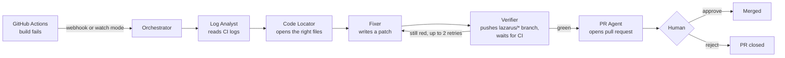

<div align="center">

# Lazarus

**Brings failed CI builds back to life.**

An agentic system that watches GitHub Actions. When CI goes red, it reads the logs, finds the broken code, writes a fix, tests it in CI and opens a pull request for a human to approve.


*Built in 24 hours at **Agentathon** (31 Oct – 1 Nov 2026), organised by **Encode.ai**, by team **FluxWave**.*


</div>

---

## Why

A red build blocks a whole team. Someone has to open the logs, scroll past runner noise, find the one line that matters, track it to the file, fix it, push and wait for CI again. Most of these failures are small: an off-by-one, a typo in an import, a bad dependency pin. Each one still costs a developer half an hour or more.

Lazarus does that loop for you. It is a team of agents rather than one prompt. Every fix it proposes has already passed **your own CI**, and nothing is merged until a human approves it.

## How it works



| Agent | What it does |
|---|---|
| **Log Analyst** | Pulls the failed job logs, strips runner noise and secrets, and classifies the failure (test, dependency, lint, type, build, config or infra). |
| **Code Locator** | Reads the repository tree and opens only the files that matter. Large files are windowed around the lines named in the error. |
| **Fixer** | Produces a minimal search-and-replace patch with its reasoning and a confidence score. |
| **Verifier** | Commits the patch to a `lazarus/*` branch and waits for GitHub Actions. If CI is still red, the new errors go back to the Fixer. |
| **PR Agent** | Opens a pull request with the diff, the reasoning, the test results and a link to the original failure. |

A live dashboard follows every step over Server-Sent Events: the agent timeline, the diff, confidence, test counts and a heartbeat monitor that goes from flatline to pulse.

## Features

- **Automatic wake-up.** Pick repositories on the dashboard. Every new CI failure in them starts a fix, through a webhook or by polling.
- **Verified fixes only.** A PR opens only after the fix passes the repository's own GitHub Actions. Nothing runs on the Lazarus server.
- **Human in the loop.** Every merge needs an explicit Approve. Reject closes the PR and deletes the branch.
- **Self-healing.** Recoverable problems pause the run instead of failing it: LLM rate limits, a token that can't push yet, CI that only runs on pull requests, GitHub outages. Lazarus resumes on its own.
- **Honest fixes.** Patches that skip or delete tests, remove assertions, silence linters (`noqa`, `type: ignore`), edit CI workflows or exceed 200 lines are rejected.
- **Infra-aware.** Flaky tests and runner outages are re-run, not "fixed" in code.
- **No loops.** Failures on its own branches are treated as test results. Old failures that a newer commit already fixed are skipped, and duplicate PRs are never opened.
- **CI bootstrap.** For repositories without CI, Lazarus detects Python or JavaScript and opens a PR that adds a suitable workflow.
- **Escalation.** When a human is really needed, Lazarus opens a GitHub issue with the logs, every attempt and the agents' notes (secrets redacted).
- **Resilient LLM layer.** Gemini with structured output, plus an OpenAI-compatible fallback (Groq). It waits as long as the provider asks, rotates models and trims prompts to fit free-tier limits.

## Tech stack

| Layer | Technology |
|---|---|
| Backend | Python, FastAPI, httpx (async GitHub REST), Pydantic, Server-Sent Events |
| LLMs | Google Gemini (JSON schema output), Groq / any OpenAI-compatible API as fallback |
| Storage | In memory, with optional MongoDB write-through for history and past-fix memory |
| Dashboard | Next.js 15, React 19, Tailwind CSS v4, Motion |
| Verification | GitHub Actions on the target repository |
| Tests | pytest with an in-memory fake GitHub and fake LLM, so the full pipeline runs offline |

## Getting started

### Prerequisites

- Python 3.11+ and Node.js 20+
- A GitHub repository with a GitHub Actions workflow that runs on `push` to every branch (or on `pull_request`)
- A Gemini API key, a Groq API key, or both

### 1. Create a GitHub token

Create a **fine-grained personal access token** from the account that **owns** the repositories. Under *Repository access*, select every repository Lazarus should fix, then set these repository permissions:

| Permission | Access | Used for |
|---|---|---|
| Contents | Read and write | Pushing the fix branch |
| Pull requests | Read and write | Opening and merging PRs |
| Actions | Read and write | Reading logs, re-running flaky jobs |
| Issues | Read and write | Escalation issues (optional) |
| Workflows | Read and write | The *Set up CI* button (optional) |

> Public repositories are readable by any token, but Lazarus can only **push** to repositories selected on the token. Run `python -m app.check <owner>/<repo>` to confirm.

### 2. Run the backend

```bash
cd backend
python -m venv .venv
source .venv/bin/activate          # Windows: .venv\Scripts\activate
pip install -r requirements-dev.txt
cp .env.example .env               # add GITHUB_TOKEN and an LLM key
python -m app.check <owner>/<repo> # checks token, push access and LLMs
uvicorn app.main:app --port 8000
```

### 3. Run the dashboard

```bash
cd dashboard
npm install
cp .env.local.example .env.local   # NEXT_PUBLIC_API_URL=http://localhost:8000
npm run dev
```

Open http://localhost:3000, click **Repositories** and switch on **Watch** for the repositories you want Lazarus to look after. From then on, every new CI failure in them is picked up automatically.

### 4. (Optional) Instant webhooks

Watch mode polls every 20 seconds and needs no public URL. For instant wake-up, add a webhook under **Settings → Webhooks** that sends **Workflow runs** events to `https://<your-host>/webhook/github`, using the secret from `GITHUB_WEBHOOK_SECRET`. For local development, [smee.io](https://smee.io) can forward events to your machine.

## Try it

`demo-app/` is a small Python project with tests and CI. Push it to a new repository, add the repository to your token and switch it on in the dashboard. Then use the **Stage demo** buttons, or `scripts/break_demo.py`, to push a failing test, a bad dependency pin or a lint error, and watch Lazarus fix it.

## Configuration

All settings live in `backend/.env`. The defaults are tuned for free-tier LLMs; see [`backend/.env.example`](backend/.env.example) for the full list.

| Variable | Default | Meaning |
|---|---|---|
| `GITHUB_TOKEN` | | Fine-grained token (see above) |
| `GEMINI_API_KEY` / `FALLBACK_API_KEY` | | At least one LLM key |
| `FALLBACK_BASE_URL` / `FALLBACK_MODEL` | Groq, `openai/gpt-oss-120b` | Any OpenAI-compatible endpoint |
| `MONGODB_URI` | empty | Optional persistence |
| `WATCH_POLL_S` | `20` | Polling interval; `0` turns watch mode off |
| `MAX_RETRIES` | `2` | Fix attempts per run when CI stays red |
| `MIN_CONFIDENCE` | `50` | Confidence below which a patch is flagged |
| `AUTO_HEAL` / `AUTO_RETRIES` / `HEAL_DELAY_S` | `true` / `3` / `60` | Self-healing behaviour |
| `MAX_CONCURRENT` | `1` | Fixes running at once; extra failures queue |
| `ESCALATE_ISSUE` | `true` | Open a GitHub issue when a human is needed |

## Project structure

```
backend/
  app/
    main.py           FastAPI app: webhook, REST API, SSE stream
    orchestrator.py   pipeline, retries, self-healing, watch mode
    agents.py         Log Analyst, Code Locator, Fixer, Verifier, PR Agent
    llm.py            Gemini + OpenAI-compatible fallback, rate-limit handling
    github_client.py  GitHub REST client
    ci_setup.py       detects the stack and proposes a CI workflow
    textutil.py       log cleaning, secret redaction, patch application, cheat guard
    store.py          run store, event bus, optional MongoDB
    check.py          pre-flight diagnostics
    cli.py            run a single fix from the terminal
  tests/              offline end-to-end tests (fake GitHub + fake LLM)
dashboard/            Next.js dashboard
demo-app/             sample repository to break and fix
scripts/              demo helpers
docs/                 screenshots
```

## API

| Method | Path | Description |
|---|---|---|
| `POST` | `/webhook/github` | GitHub `workflow_run` webhook (HMAC-verified) |
| `POST` | `/api/runs/trigger` | Fix the latest failure in a repository |
| `GET` | `/api/runs`, `/api/runs/{id}` | List runs / run detail with steps and attempts |
| `POST` | `/api/runs/{id}/approve` | Merge the PR |
| `POST` | `/api/runs/{id}/reject` | Close the PR and delete the branch |
| `POST` | `/api/runs/{id}/retry` | Retry a stopped run |
| `GET` | `/api/stream` | Live events (Server-Sent Events) |
| `GET` / `POST` | `/api/repos`, `/api/repos/watch` | Repositories the token can reach; watch on/off |
| `GET` / `POST` | `/api/repos/ci`, `/api/repos/ci/setup` | CI status and push access; propose a workflow |
| `GET` | `/api/stats`, `/health` | Totals and health check |

## Safety

- Lazarus **never merges on its own**. Every merge is an explicit human approval.
- Proposed code runs only inside the target repository's GitHub Actions, never on the Lazarus server.
- Secrets are redacted from logs before they reach the LLM, pull requests or issues.
- CI logs and code are treated as data. The agents can only propose edits through a fixed schema.
- Edits to `.github/`, binary files and oversized patches are refused.

## Testing

```bash
cd backend
pytest -q
```

83 tests cover the full pipeline end to end against an in-memory GitHub and LLM. They include retries, escalation, self-healing, rate limits, loop prevention, multi-repo watch mode, CI setup, large files and the safety guards. No keys or network access are needed.

## Deployment

`render.yaml` deploys the backend to [Render](https://render.com). Set the environment variables there and point the dashboard's `NEXT_PUBLIC_API_URL` at it. The dashboard deploys to any Next.js host, such as Vercel.

## Origin

Lazarus was designed and built from scratch during **Agentathon**, a 24-hour hackathon organised by **Encode.ai** (31 October – 1 November 2026), by team **FluxWave** ([ItsShannu44](https://github.com/ItsShannu44)). The commit history of this repository records its development.